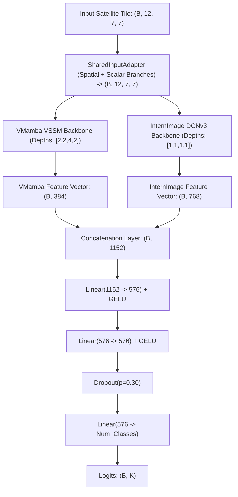

# PROJECT OVERVIEW & IMPLEMENTATION GUIDE: RAJASTHAN CROP CLASSIFICATION (MODELS_DL)

> **Document Purpose:** This document serves as the single source of truth for the `Models_DL` crop classification project. It contains complete architectural specifications, dataset schemas, mathematical formulations, implementation details for every notebook file, experimental baselines, and operational rules for human researchers and AI agents.

---

## 1. Executive Summary & Research Scope

* **Domain:** Remote Sensing & Precision Agriculture / Multi-Spectral Satellite Image Classification.
* **Geographic Scope:** Rajasthan, India.
* **Target Objective:** Accurate pixel/tile classification of agricultural crops across two distinct growing seasons:
  1. **Kharif Season** (Monsoon/Autumn harvest): 16 crop classes, 111,956 samples.
  2. **Rabi Season** (Winter/Spring harvest): 13 crop classes, 129,015 samples.
* **Target Accuracy:** 85%+ classification accuracy (scientific exploration target, not an artificially fabricated figure).
* **Current Best Result:** **76.79% Test Accuracy / 78.38% Validation Accuracy** (Achieved by `06_Hybrid_InternImage_VMamba_Rabi_Adam.ipynb` at 100 epochs, up from the single-model baseline of 63.24%).

### Non-Negotiable Research Constraints
1. **Adam Optimizer:** Adam must be retained as the primary optimizer for all experiments.
2. **Approved Frozen Splits:** Exact sample indices are frozen in `SPLITS/` (80% Train, 10% Validation, 10% Test). They must never be regenerated or altered.
3. **Training-Only Normalization:** Channel-wise mean and standard deviation statistics must be computed **strictly on the training split indices**. Never use validation or test data for statistics (zero data leakage).
4. **Preserve Raw Pickles:** Raw pickle datasets (`FINAL_KHARIF.pickle`, `FINAL_RABI.pickle`) are read-only.
5. **No Test-Set Model Selection:** Checkpoints and hyperparameter decisions are strictly governed by validation performance (`val_acc` or `val_loss`). The test split is evaluated only once on the selected checkpoint.
6. **Self-Contained Notebooks:** All six notebooks in `Models_DL` must remain completely self-contained. No runtime dependencies or local imports from outside `Models_DL` (e.g., `01_CODE`, `08_COMMON`).

---

## 2. Dataset Architecture & Pickle File Schema

The raw datasets are serialized Python dictionaries stored in:
* `Models_DL/FINAL_KHARIF.pickle` (~525 MB)
* `Models_DL/FINAL_RABI.pickle` (~605 MB)

### 2.1 Python Object Schema
```python
dict {
    "<crop_class_name>": [
        {
            "coords": [float, float],           # [latitude, longitude], e.g., [25.4190, 76.5203]
            "res":    [float, float],           # Spatial pixel resolution [dy, dx]
            "data":   np.ndarray(12, 7, 7)      # Shape (12 channels, 7 height, 7 width), dtype=float64
        },
        ...
    ],
    ...
}
```

### 2.2 Canonical Flattening Pattern
Every notebook extracts tensors and targets deterministically:
```python
classes = sorted(raw.keys())
class_to_id = {c: i for i, c in enumerate(classes)}
id_to_class = {i: c for c, i in class_to_id.items()}
arrays, labels = [], []
for c in classes:
    for s in raw[c]:
        if isinstance(s, dict) and 'data' in s:
            arrays.append(s['data'])
        else:
            arrays.append(s)
        labels.append(c)
```

### 2.3 Channel Spectral Physics & Spatio-Scalar Breakdown
The input tensor has shape $(12, 7, 7)$ representing 12 satellite bands / features over a $7 \times 7$ spatial window.

| Channel Range | Physical Property | Spatial Behavior in $7 \times 7$ Tile | Empirical Within-Tile Std | Fisher Discriminability Ratio | Role in Model |
| :--- | :--- | :--- | :--- | :--- | :--- |
| **Channels 0–6** | Surface Reflectance (Multi-spectral bands) | True spatial variation (spatial field gradient) | $0.026 - 0.109$ (Within/Global ratio: $0.41 - 0.63$) | $0.15 - 0.24$ (Moderate) | Extracted by 2D spatial convolutions & selective scan. |
| **Channel 7** | Spectral / Elevation Index | High magnitude spatial variation | $99.4$ (Within/Global ratio: $0.63$) | $0.23$ | Normalized spatially. |
| **Channels 8–11** | Environmental / Temporal Scalar Indicators | **Completely flat** across $7 \times 7$ tile (zero spatial variance) | **$0.0000$** (Constant across all 49 pixels) | **$0.80 - 1.61$** (**Highest discriminative power!**) | Must be extracted via scalar projection branch, not spatial kernels. |

> **Critical Discovery:** Channels 8–11 have an empirical within-tile standard deviation of **0.0000**, yet their Fisher criterion (between-class variance / within-class variance) is **$4\times$ to $10\times$ higher** than channels 0–7. Naive $12 \to 3$ spatial convolutions collapsed and diluted these channels. The dual-branch `InputAdapter` explicitly solves this.

### 2.4 Class Distributions & Class Imbalance

#### Kharif Season (16 Classes, Total = 111,956)
* Classes: `Black gram` (7,743), `Castor` (10,178), `Corn` (7,114), `Cotton` (1,062), `Cowpea` (10,484), `Flax` (5,323), `Green gram` (10,226), `Groundnut` (6,584), `Guar` (1,285), `Matbean` (2,036), `Onion` (10,087), `Pearl millet` (7,044), `Rice` (7,678), `Sesame` (10,052), `Sorghum` (7,168), `Soybean` (7,892).
* **Imbalance Ratio:** **$9.9\times$** (`Cotton` is $0.9\%$, `Cowpea` is $9.4\%$).
* **Mitigation:** Balanced class-weighted Cross-Entropy loss.

#### Rabi Season (13 Classes, Total = 129,015)
* Classes: `Barley` (8,614), `Coriander` (9,602), `Cumin` (9,682), `Fenugreek` (11,101), `Gram` (10,637), `Linseed` (9,198), `Masur` (10,360), `Mustard` (11,031), `Onion` (10,431), `Potato` (7,497), `Sunflower` (10,908), `Taramira` (9,870), `Wheat` (10,084).
* **Imbalance Ratio:** **$1.5\times$** (Nearly uniform distribution).
* **Challenge:** High spectral overlap among winter cereals (Wheat, Barley, Linseed, Masur).

---

## 3. Data Integrity, Splits & Preprocessing Engine

### 3.1 Approved Frozen Splits (`Models_DL/SPLITS/`)
All samples are indexed deterministically using stratified 80/10/10 partitions:
* `kharif_train_idx.npy`: shape `(89564,)` | `kharif_val_idx.npy`: shape `(11194,)` | `kharif_test_idx.npy`: shape `(11198,)`
* `rabi_train_idx.npy`: shape `(103213,)` | `rabi_val_idx.npy`: shape `(12901,)` | `rabi_test_idx.npy`: shape `(12901,)`

**Zero-Leakage Assertion (Mandatory Check):**
```python
assert len(set(train_idx) & set(val_idx)) == 0, "TRAIN/VAL OVERLAP DETECTED!"
assert len(set(train_idx) & set(test_idx)) == 0, "TRAIN/TEST OVERLAP DETECTED!"
assert len(set(val_idx) & set(test_idx)) == 0, "VAL/TEST OVERLAP DETECTED!"
```

### 3.2 Normalization Formula (Training-Subset Only)
Per-channel mean $\mu_c$ and standard deviation $\sigma_c$ are computed over all pixels of the training samples only:
$$\mu_c = \frac{1}{N_{\text{train}} \cdot 7 \cdot 7} \sum_{i \in \text{train}} \sum_{h=1}^7 \sum_{w=1}^7 X_{i, c, h, w}, \quad \sigma_c = \sqrt{\frac{1}{N_{\text{train}} \cdot 49} \sum_{i \in \text{train}} \sum_{h, w} (X_{i, c, h, w} - \mu_c)^2}$$
Clamped standard deviation: $\sigma_c = \max(\sigma_c, 10^{-6})$.

Applied in `CropDataset.__getitem__`:
$$X_{\text{norm}, c} = \frac{X_c - \mu_c}{\sigma_c + 10^{-7}}$$

### 3.3 Scientifically Valid Satellite Spatial Augmentation
Applied exclusively to the training set (`augment = not SMOKE_TEST`):
* **Horizontal Flip ($p = 0.5$):** Reflected along spatial dimension $W$.
* **Vertical Flip ($p = 0.5$):** Reflected along spatial dimension $H$.
* **Orthogonal Rotation ($90^\circ, 180^\circ, 270^\circ$ with $p = 0.75$):** Spatial rotation invariant for nadir satellite imagery.
* *Explicitly Excluded:* Color jitter, Gaussian blur, and CutOut/MixUp (these corrupt multi-spectral reflectance and physical band ratios).

---

## 4. Deep Model Architecture Specifications

### 4.1 Dual-Branch Spatial-Scalar Input Adapter
Every architecture in `Models_DL` uses this custom adapter to preserve both spatial and scalar information without bottlenecking:
```
Input: (B, 12, 7, 7)
  ├── Spatial Branch: Conv2d(12 -> out_ch, 1x1, bias=False) -> BatchNorm2d -> GELU
  └── Scalar Branch:  Slice Ch[8:11] -> Mean(-1, -2) -> (B, 4) -> Linear(4 -> out_ch) -> Reshape (B, out_ch, 1, 1) -> Expand (B, out_ch, 7, 7)
Merged Output:
  Output = sigmoid(blend) * Spatial + (1 - sigmoid(blend)) * Scalar   [Shape: (B, out_ch, 7, 7)]
```
* `out_ch = 12` (Prevents the historical $12 \to 3$ channel bottleneck).
* `blend` is a learnable parameter initialized to $0.5$.

---

### 4.2 VMamba Classifier Architecture (Notebooks 01 & 02)
* **Backbone:** Visual State Space Model (`VSSM`).
* **Input:** $(B, 12, 7, 7) \xrightarrow{\text{InputAdapter}} (B, 12, 7, 7)$.
* **Stem:** Patch size = 1, `in_chans = 12`, `dims = 48`.
* **Depths:** `[2, 2, 4, 2]` across 4 hierarchical stages.
* **Core Operator:** 2D Selective Scan (`SS2D`) with 4-way Cross-Scan (`CrossScanF`) and Cross-Merge (`CrossMergeF`):
  * Direction 0: Row-major $(H \times W)$.
  * Direction 1: Column-major $(W \times H)$.
  * Direction 2: Flipped row-major.
  * Direction 3: Flipped column-major.
* **Scan Implementation:** Pure-PyTorch selective scan (`v05_noz`) for maximum portability without requiring compilation of Triton or CUDA C++ extensions.
* **Spatial Flow:** $7 \times 7 \to 7 \times 7 \to 4 \times 4 \to 2 \times 2 \to 1 \times 1$.
* **Classification Head:** Linear layer on top of final 384-dimensional feature vector $\to (B, K)$.
* **Total Parameters:** ~2,100,000.

---

### 4.3 InternImage Classifier Architecture (Notebooks 03 & 04)
* **Backbone:** Deformable Convolutional Network v3 (`DCNv3_pytorch`).
* **Input:** $(B, 12, 7, 7) \xrightarrow{\text{InputAdapter12}} (B, 12, 7, 7)$.
* **MicroStemLayer:** Conv2d($12 \to 64$, $3 \times 3$, stride=1, padding=1) + BatchNorm2d + GELU $\to$ Permute to `channels_last` $(B, 7, 7, 64)$.
* **Stages:** 4 levels with `depths = [1, 1, 1, 1]` and `groups = [1, 2, 4, 8]`:
  * Level 0: 64 channels, downsample=True $\to 4 \times 4$.
  * Level 1: 128 channels, downsample=True $\to 2 \times 2$.
  * Level 2: 256 channels, downsample=True $\to 1 \times 1$.
  * Level 3: 512 channels, downsample=False $\to 1 \times 1$.
* **DCNv3 Operator:** Pure-PyTorch implementation utilizing bilinear sampling grid (`F.grid_sample`) with learned dynamic offsets and modulation masks.
* **Classifier Head:** Conv2d($512 \to 768$, $1 \times 1$) + BatchNorm2d + GELU + AdaptiveAvgPool2d + Linear($768 \to K$).
* **Total Parameters:** ~5,598,000.

---

### 4.4 Hybrid InternImage + VMamba Fusion Architecture (Notebooks 05 & 06)
Feature-level fusion combining the local deformable receptive fields of InternImage with the global long-range context of VMamba:



* **No Logit Averaging:** True feature fusion occurs in high-dimensional embedding space before classification.
* **Gradient Flow:** Backpropagation flows smoothly into both branches simultaneously through the concatenation and shared adapter.
* **Total Parameters:** ~10,580,000.

---

## 5. File-by-File Implementation Breakdown

### 5.1 Notebook Catalog
| Notebook File | Season | Classes | Backbone Architecture | Primary Research Objective |
| :--- | :--- | :--- | :--- | :--- |
| `01_VMamba_Kharif_Adam.ipynb` | Kharif | 16 | VMamba (VSSM v05_noz) | Evaluate State Space Models under severe class imbalance ($9.9\times$). |
| `02_VMamba_Rabi_Adam.ipynb` | Rabi | 13 | VMamba (VSSM v05_noz) | Evaluate State Space Models on spectrally overlapping winter crops. |
| `03_InternImage_Kharif_Adam.ipynb` | Kharif | 16 | InternImage (DCNv3) | Benchmark deformable convolutions on Kharif monsoon crops. |
| `04_InternImage_Rabi_Adam.ipynb` | Rabi | 13 | InternImage (DCNv3) | Benchmark deformable convolutions on Rabi winter crops. |
| `05_Hybrid_InternImage_VMamba_Kharif_Adam.ipynb` | Kharif | 16 | Hybrid DCNv3 + VMamba | Feature fusion evaluation for 16-class Kharif classification. |
| `06_Hybrid_InternImage_VMamba_Rabi_Adam.ipynb` | Rabi | 13 | Hybrid DCNv3 + VMamba | Feature fusion evaluation for 13-class Rabi classification. |

### 5.2 Canonical Notebook Structure (Cells 1 to 9)
Every notebook follows an identical 9-cell modular layout:
1. **Cell 1 — Library Imports & Stubs:** Imports PyTorch, NumPy, Scikit-Learn, Seaborn. Injects safe fallback stubs for optional modules (`fvcore`, `triton`, `mamba2`, `timm`).
2. **Cell 2 — Experiment Configuration:** Sets hyperparameters (`BATCH_SIZE=128`, `NUM_WORKERS=4`, `LR=1e-4`, `WEIGHT_DECAY=1e-4`, `ES_PATIENCE=15`, `SCHED_PATIENCE=8`, `USE_AMP=True`, `SMOKE_TEST=True`).
3. **Cell 3 — Dataset Loading & Quality Audit:** Unpickles dataset, verifies shapes, checks for NaN/Inf, and prints class frequency histograms.
4. **Cell 4 — Splits, Normalization & DataLoader:** Loads frozen `.npy` splits, checks zero overlap, computes train-only mean/std, constructs `CropDataset` with augmentation, and instantiates DataLoaders with `drop_last=True`.
5. **Cell 5 — Inline Architecture Definition:** Complete inline definition of operators (DCNv3/CrossScan), InputAdapter, backbones, and classification head. Performs forward pass shape verification.
6. **Cell 6 — Training Engine:** Adam optimizer with parameter-specific weight decay grouping. 5-epoch linear warmup followed by `ReduceLROnPlateau(factor=0.5, patience=8)`. Early stopping on `val_loss`. Saves best checkpoint by `val_acc`.
7. **Cell 7 — Test Set Evaluation:** Loads `best_model.pth` (selected purely on validation data). Runs inference on untouched test split. Computes Accuracy, Macro-F1, Weighted-F1, and per-class classification report.
8. **Cell 8 — Plot Generation:** Saves 4 diagnostic figures to `Results/`: `training_curves.png`, `confusion_matrix.png`, `per_class_accuracy.png`, and `lr_curve.png`.
9. **Cell 9 — Final Experiment Report:** Prints formatted metadata, peak GPU memory, total parameters, and exact execution duration.

---

## 6. Training, Optimization & Checkpointing Protocol

### 6.1 Optimizer Configuration (Adam)
SSM parameters ($A_{\text{log}}$, $D$) and convolutional offsets/biases must not be decayed:
```python
def is_no_wd(name):
    return 'A_log' in name or name.endswith('.D') or 'bias' in name or 'offset' in name or 'mask' in name

no_wd = [p for n, p in model.named_parameters() if p.requires_grad and is_no_wd(n)]
wd    = [p for n, p in model.named_parameters() if p.requires_grad and not is_no_wd(n)]

optimizer = torch.optim.Adam([
    {'params': wd,    'weight_decay': 1e-4},
    {'params': no_wd, 'weight_decay': 0.0}
], lr=1e-4, betas=(0.9, 0.999), eps=1e-8)
```

### 6.2 Learning Rate Warmup & Scheduling
* **Linear Warmup (Epochs 1–5):**
  $$\text{LR}(e) = \text{LR}_{\text{base}} \times \left(\frac{e}{\text{WARMUP\_EPOCHS}}\right)$$
* **Plateau Decay (Epochs 6+):**
  Monitors `val_loss`. If no improvement by at least $10^{-4}$ for `patience = 8` epochs:
  $$\text{LR} \leftarrow \max(\text{LR} \times 0.5, 10^{-6})$$

### 6.3 Early Stopping
* Monitored Metric: `val_loss`.
* Patience: 15 epochs.
* Best Checkpoint Metric: Strictly saved when `val_acc > best_val_acc`.

### 6.4 Mixed Precision & cuDNN Acceleration
* `torch.cuda.amp.autocast(enabled=True)` with `torch.cuda.amp.GradScaler()` for FP16 Tensor Core execution.
* `torch.backends.cudnn.benchmark = True` enabled for fixed-size $(12, 7, 7)$ tensor throughput.

---

## 7. Verified Experimental Results & Empirical Progress

### 7.1 Rabi Season Progression (13 Classes)

| Model Architecture | Epochs | Batch Size | Best Val Accuracy | Test Accuracy | Test Macro-F1 | Test Weighted-F1 | Peak VRAM | Training Time |
| :--- | :--- | :--- | :--- | :--- | :--- | :--- | :--- | :--- |
| **Linear Upper Bound (LogReg)** | — | — | 41.86% | 39.56% | 37.42% | 38.90% | CPU | ~1.5 min |
| **InternImage Baseline** | 100 | 32 | 63.57% | **63.24%** | 62.99% | 63.13% | 0.19 GB | 139.3 min |
| **Hybrid (InternImage + VMamba)** | 100 | 128 | **78.38%** | **76.79%** | **76.45%** | **76.57%** | 3.66 GB | 1457.3 min |
| **Net Progress** | — | — | **+14.81%** | **+13.55%** | **+13.46%** | **+13.44%** | — | — |

### 7.2 Rabi Hybrid Per-Class Performance Breakdown (Test Split: 12,901 Samples)

| Crop Name | Support | Precision | Recall | F1-Score | Status / Diagnosis |
| :--- | :--- | :--- | :--- | :--- | :--- |
| **Cumin** | 968 | 0.86 | 0.89 | **0.88** | Excellent separation |
| **Gram** | 1,063 | 0.83 | 0.87 | **0.85** | Strong feature separation |
| **Mustard** | 1,103 | 0.87 | 0.79 | **0.83** | Strong feature separation |
| **Wheat** | 1,009 | 0.84 | 0.83 | **0.83** | High separation among cereals |
| **Barley** | 862 | 0.77 | 0.84 | **0.80** | Good separation |
| **Onion** | 1,043 | 0.78 | 0.81 | **0.80** | Good separation |
| **Fenugreek** | 1,110 | 0.89 | 0.72 | **0.79** | High precision, lower recall |
| **Coriander** | 960 | 0.62 | 0.93 | **0.75** | High recall, lower precision |
| **Taramira** | 987 | 0.77 | 0.73 | **0.75** | Moderate spectral overlap |
| **Potato** | 749 | 0.66 | 0.75 | **0.71** | Moderate spectral overlap |
| **Linseed** | 920 | 0.70 | 0.71 | **0.70** | Confused with other small grains |
| **Sunflower** | 1,091 | 0.73 | 0.66 | **0.70** | Confused with broadleaf vegetation |
| **Masur (Lentil)** | 1,036 | 0.69 | **0.48** | **0.56** | **Primary Bottleneck** (confused with pulses) |

---

## 8. Operating Instructions for Human Researchers & AI Agents

### 8.1 How to Run Smoke Test (Static & Execution Verification)
To verify that code executes without errors before committing a 24-hour run:
1. Open the target notebook in Jupyter.
2. In Cell 2, verify `SMOKE_TEST = True` (limits execution to 2 batches, 2 epochs).
3. Click **Kernel $\to$ Restart & Run All**. Expected execution time: $< 45$ seconds.

### 8.2 How to Launch Full Training on GPU Server
1. Ensure the PyTorch environment is active:
   ```bash
   conda activate shivamsen
   cd /path/to/crop-classification/Models_DL
   ```
2. Open the notebook and modify Cell 2:
   ```python
   SMOKE_TEST = False
   BATCH_SIZE = 128
   NUM_WORKERS = 4
   MAX_EPOCHS = 100
   USE_AMP = True
   ```
3. Execute **Kernel $\to$ Restart & Run All**.
4. Check that outputs and model weights are written to `Models_DL/Results/<Season>/<Architecture>/best_model.pth`.

### 8.3 Rules for Future AI Agents
* **Do NOT delete or rename `SPLITS/*.npy`:** These contain the frozen indices.
* **Do NOT import modules from `01_CODE`, `08_COMMON`, or external dirs:** All model components are embedded directly in each notebook.
* **Do NOT compute normalization on validation or test sets:** Doing so invalidates scientific reproducibility.
* **Do NOT replace DCNv3 or VMamba with standard ResNets or CNNs:** The research focuses specifically on State Space Models (SSM) and Deformable Convolutions.
* **Do NOT alter test set evaluation:** Test evaluation must happen strictly after training concludes using `torch.load(CKPT_PATH)`.
